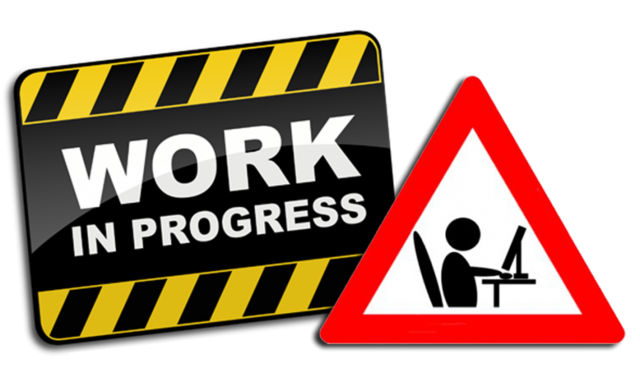

Alignement
==============================

.. _alignment_page:

L':term:`alignement de canaux <Alignement de canaux>` exprime les :term:`localisations <Localisation>` de plusieurs canaux dans le même repère.

Page en cours d'écriture.
