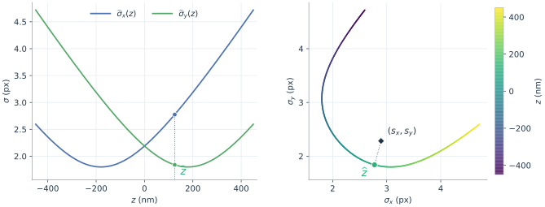

Astigmatisme 3D
===============

.. _astig_page:

L':term:`astigmatisme 3D <Astigmatisme 3D>` permet d'estimer la position axiale :math:`z` à partir de la forme de la :term:`PSF <PSF (Point Spread Function)>`.
Un astigmatisme optique, introduit par exemple par une lentille cylindrique, sépare les plans de focalisation selon les deux axes.
La tache s'élargit davantage selon l'un ou l'autre axe de part et d'autre de la zone où les largeurs se croisent.
`Huang et al. (2008) <https://pmc.ncbi.nlm.nih.gov/articles/PMC2633023/>`_

Un :ref:`ajustement gaussien elliptique <fit_page>` fournit les deux largeurs en pixels. La calibration établit leurs variations avec Z,
puis l'estimation inverse retrouve la position axiale à partir du couple observé.

Modèle et calibration
---------------------

Pour chaque axe :math:`a\in\{x,y\}`, le modèle d'astigmatisme prédit la largeur :math:`\widehat\sigma_a(z)` en pixels.
Si :math:`p` est la taille du pixel d'acquisition en nm/px, on utilise

.. math::

   u_a=\frac{z-Z_{0,a}}{W_a},
   \qquad
   \widehat\sigma_a(z)=\frac{A_a}{p}\sqrt{\max\!\left(0,\ 1+u_a^2+C_{3,a}u_a^3+C_{4,a}u_a^4\right)}.

:math:`Z_{0,a}` situe la courbe sur l'axe Z, :math:`W_a` règle son échelle axiale et :math:`A_a` est la largeur au point :math:`z=Z_{0,a}`.
Ces trois paramètres sont en nanomètres. Le coefficient cubique :math:`C_{3,a}` modifie l'asymétrie de la courbe et
le coefficient quartique :math:`C_{4,a}` modifie sa forme loin du foyer. Le CSV du modèle contient une ligne par axe.

#. On mesure les deux largeurs d'une ou de plusieurs billes à des positions axiales connues. Dans l':ref:`outil de calibration <tool_astig_page>`,
   Z peut aussi être déduit du numéro de plan et du pas axial.
#. Le cœur CPU ajuste séparément les courbes X et Y par Levenberg–Marquardt. Il minimise la somme des carrés des écarts entre les largeurs
   mesurées et prédites aux Z de référence. Le modèle impose des largeurs positives sur l'intervalle de calibration.
#. Lorsque le recentrage est activé, l'origine est placée au croisement des courbes ou près du point où les largeurs sont les plus proches.
   Si les billes sont identifiées séparément dans le CSV, l'outil calibre un modèle par bille, moyenne leurs paramètres, puis recentre la moyenne si demandé.

Estimation de Z
---------------

Pour une localisation dont l'ajustement donne les largeurs :math:`s_x,s_y`, la DLL cherche le point de la courbe
:math:`z\mapsto(\widehat\sigma_x(z),\widehat\sigma_y(z))` le plus proche du couple mesuré dans le plan des largeurs.
La fonction à minimiser sur :math:`[-Z_{\max},Z_{\max}]` est

.. math::

   E(z)=\bigl[s_x-\widehat\sigma_x(z)\bigr]^2+\bigl[s_y-\widehat\sigma_y(z)\bigr]^2.

   Exemple synthétique. À droite, le segment relie le couple mesuré au point le plus proche de la courbe. À gauche, l'abscisse de ce point donne :math:`\widehat z`.

L'estimateur évalue d'abord le coût sur une grille uniforme qui inclut les deux bornes. Il affine ensuite le meilleur candidat par la méthode de Brent
dans un voisinage de ce point. Le résultat retenu est celui des deux candidats qui donne le coût le plus faible, et la colonne ``Z`` l'exprime en nanomètres.
Le même calcul est utilisé dans l'outil de calibration et dans le :ref:`pipeline <pipeline_page>` lorsque l'option :guilabel:`3D` est activée.

Score de compatibilité
----------------------

Le cœur calcule un score de compatibilité entre les largeurs mesurées et prédites à la position retenue :math:`\widehat z`.
Il convertit l'écart relatif quadratique moyen sur les deux axes en un score compris entre 0 et 1.

.. math::

   r^2=\frac12\sum_{a\in\{x,y\}}
        \left(\frac{s_a-\widehat\sigma_a(\widehat z)}{\widehat\sigma_a(\widehat z)}\right)^2,
   \qquad Q_Z=\frac{1}{1+r^2/0.20^2}.

Un accord exact donne 1, un écart relatif RMS de 20 % donne 0,5 et une largeur invalide donne 0.
La colonne historique ``MSE Z`` contient ce score. Les anciens résultats peuvent y contenir la somme des carrés en pixels carrés,
pour laquelle les faibles valeurs étaient les meilleures.

Le score renseigne sur l'accord avec le modèle. La précision axiale dépend aussi de la variation des largeurs avec Z. Si la courbe varie peu
ou si deux portions de la courbe sont proches, un bon score peut correspondre à une position axiale mal déterminée.
Utilisez un domaine de recherche cohérent avec la calibration et conservez les mêmes conventions de largeur et d'angle pour la calibration et les mesures.
