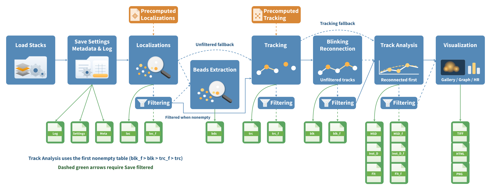

Pipeline des traitements
========================

.. _pipeline_page:

:guilabel:`Start Processing` lance les étapes ci-dessous selon les réglages du widget principal.
Pour tester la localisation sur quelques plans, utilisez d'abord l'aperçu.

Piles et dossier de résultats
-----------------------------

:guilabel:`Only one` traite la pile sélectionnée. :guilabel:`Each File separately` traite chaque pile indépendamment.
:guilabel:`All in One` concatène les piles dans l'ordre de la liste. Leurs dimensions X et Y doivent correspondre.

Le dossier de résultats porte le suffixe :file:`_PALM_Tracer` (par exemple :file:`stack_PALM_Tracer` pour :file:`stack.tif`).
En mode :guilabel:`All in One`, le nom vient du premier fichier de la liste.
Chaque traitement associe les sorties à un horodatage partagé par :file:`settings-<horodatage>.json`,
:file:`meta-<horodatage>.csv` et :file:`log-<horodatage>.log`.

Ordre des calculs et du filtrage
--------------------------------

   Les résultats réutilisables figurent au-dessus des calculs. Les fichiers produits figurent en dessous.

#. :guilabel:`Localization` détecte et ajuste les émetteurs sur chaque plan. Lorsque l'estimation axiale est activée,
   elle renseigne également Z à partir du modèle d'astigmatisme. **Après la localisation**, le pipeline applique les filtres de localisation activés.
#. :guilabel:`Beads Extraction` extrait les trajectoires des billes fiduciaires à partir des localisations filtrées si leur tableau est non vide,
   et des localisations non filtrées dans les autres cas.
   Le fichier :file:`beads-<horodatage>.csv` sert à la correction de dérive et à l'exclusion des billes dans la reconstruction haute résolution.
#. :guilabel:`Tracking` relie les localisations entre plans en privilégiant lui aussi le tableau filtré s'il est non vide.
   **Après le suivi**, le pipeline applique les critères activés sur les plans, les identifiants, la longueur et le pourcentage de points dans la ROI.
#. :guilabel:`Blinking Reconnection` utilise le **suivi non filtré**. La reconnexion peut ainsi relier des segments courts qu'un filtre de longueur
   aurait écartés. **Après la reconnexion**, le pipeline applique les mêmes critères de filtrage aux trajectoires reconnectées.
#. :guilabel:`Track Analysis` calcule le :term:`MSD <MSD (Mean Squared Displacement)>`, la :term:`diffusion instantanée <Diffusion instantanée>`
   ou un ajustement du mouvement. Elle cherche successivement un tableau non vide parmi les trajectoires reconnectées et filtrées,
   les trajectoires reconnectées, le suivi filtré, puis le suivi non filtré.
   **Après les analyses**, le pipeline applique les critères de filtrage des trajectoires et les filtres activés sur les mesures disponibles,
   puis conserve les mêmes identifiants de trajectoire dans les tableaux filtrés de suivi et d'analyse.
#. :guilabel:`Gallery`, :guilabel:`Graph` et :guilabel:`HR` génèrent les sorties activées dans :guilabel:`Visualization`.

Enregistrement des résultats filtrés
------------------------------------

Les tableaux filtrés sont disponibles en mémoire. Pour les enregistrer en CSV pendant le traitement, cochez :guilabel:`Save filtered`
dans :guilabel:`Filtering`. Seuls les tableaux filtrés non vides sont enregistrés, par exemple
:file:`localizations_filtered-<horodatage>.csv` ou :file:`tracking_reconnected_filtered-<horodatage>.csv`.
Pour la localisation, le suivi et la reconnexion, le filtrage doit avoir réduit le nombre de lignes. Après les analyses,
l'écriture des résultats filtrés se déclenche si le nombre de lignes du tableau MSD change.

Réutilisation des résultats
---------------------------

Le pipeline peut reprendre les résultats du dernier traitement si les réglages et les étapes amont le permettent.
Un calcul en amont invalide généralement la réutilisation en aval. L'extraction des billes peut réutiliser un résultat antérieur malgré cette invalidation.
Le journal indique les étapes calculées, reprises ou ignorées. Les fichiers de résultats repris sont renommés avec le nouvel horodatage.
