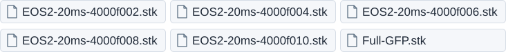
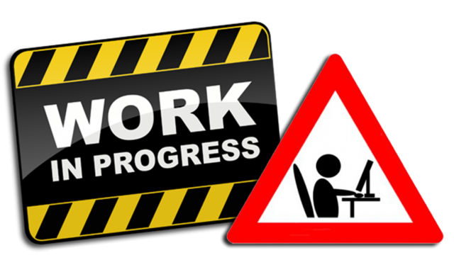
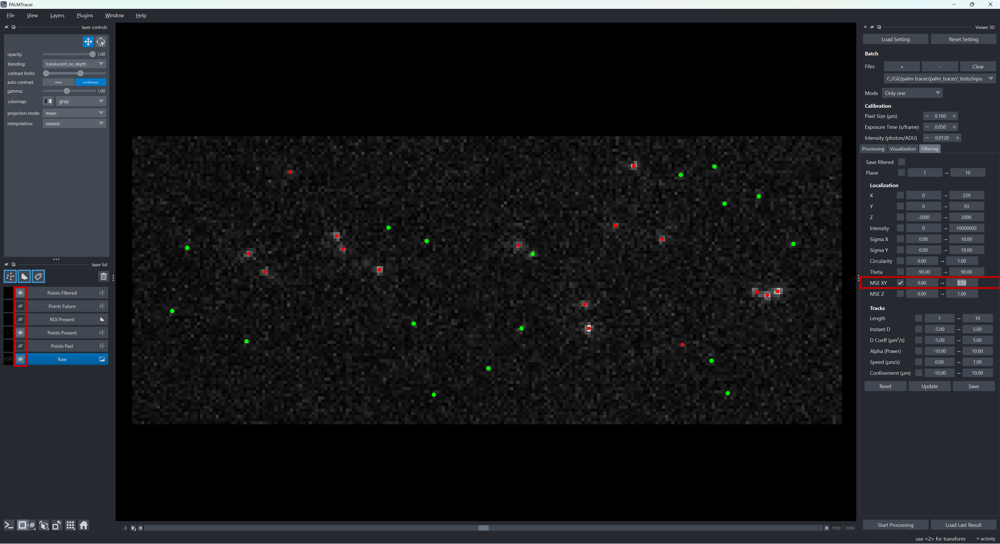
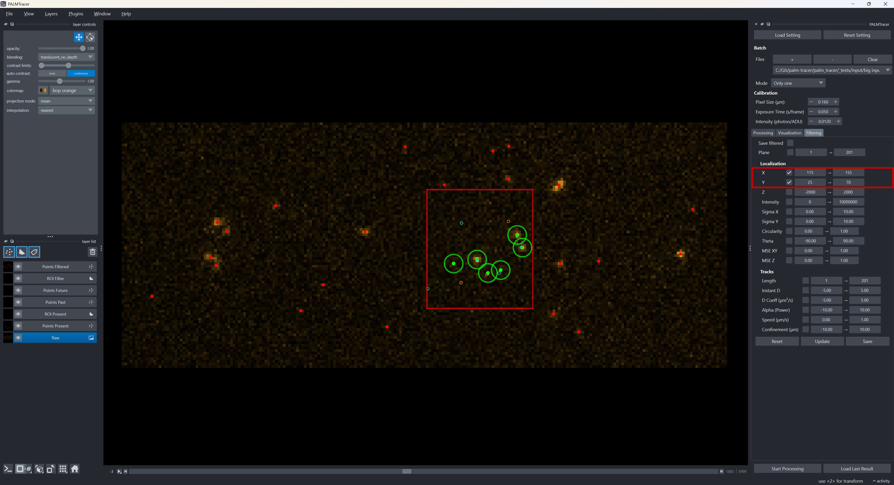
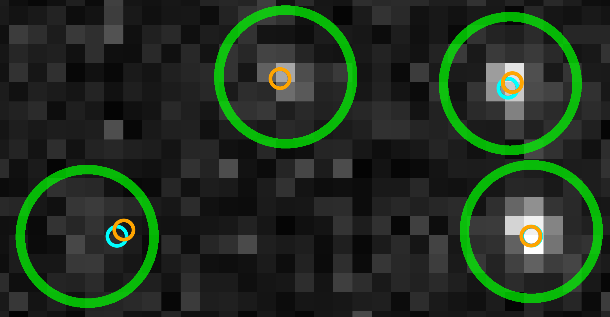
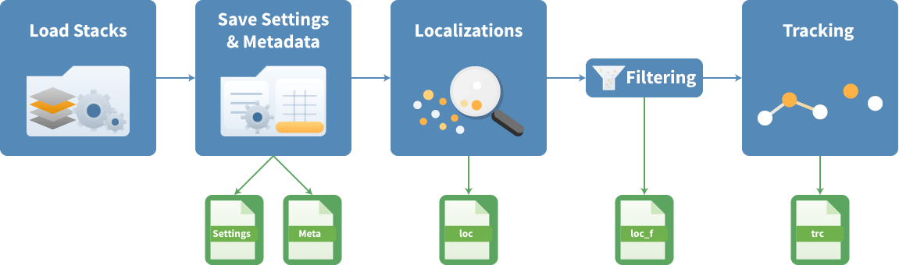

Cas 1 : Single Particle Tracking (SPT)
===================================================

Ce tutoriel montre comment régler la localisation sur une pile de :term:`SPT <SPT (Single-Particle Tracking)>`, puis calculer et vérifier les trajectoires.

Après l':ref:`installation <install_page>`, ouvrez :menuselection:`Plugins --> PALM Tracer --> PALM Tracer` dans Napari.

Ouvrir les fichiers
---------------------------------------------------

L'acquisition comprend cinq piles MetaMorph de 4 000 plans, soit 20 000 plans au total. Leurs noms vont de
:file:`EOS2-20ms-4000f002.stk` à :file:`EOS2-20ms-4000f010.stk` par pas de deux.
Gardez :file:`Full-GFP.stk` à part comme image de référence.

Commencez avec :file:`EOS2-20ms-4000f002.stk`. Ajoutez-la avec :guilabel:`Batch` → :guilabel:`Add` ou déposez-la dans Napari,
puis laissez :guilabel:`Only one` sélectionné. Une seule pile suffit pour régler les paramètres et vérifier les premières trajectoires.

   Batch avec les fichiers...

Dans :guilabel:`Calibration`, renseignez une taille de pixel de 160 nm. Vérifiez cette valeur avec la calibration du microscope.
Pour convertir les durées et calculer la diffusion, renseignez l'intervalle entre deux plans dans :guilabel:`Time Step (s/plane)`.
Le nom des fichiers indique 20 ms d'exposition. Saisissez 0,020 s par plan si les métadonnées confirment cette cadence.

   Calibration Paramétré.

Le calque :guilabel:`Raw` s'ouvre au plan central. Ajustez le contraste et parcourez les plans avec le curseur de dimensions.
**Ajouter un point sur les autres calques (peut-etre aussi le lien où je parle du volet calque dnas manuel)**

   Visualisation de Napari **changer la color map pour voir un peu plus mieux, aussi les rectangles rouge pour voir qui est ou dnas ce qu'on raconte**

Localisation
------------

Prévisualisation
^^^^^^^^^^^^^^^^^^^

Dans :guilabel:`Processing`, activez :guilabel:`Localization`, puis cochez :guilabel:`Preview`.
Sur le plan illustré, :guilabel:`Auto Threshold` propose 130,86. À cette valeur, certains points faibles disparaissent de l'aperçu.
Abaissez le seuil à 60 pour les récupérer et éviter des ruptures de trajectoires. Ce réglage ajoute aussi des détections de fond.
Parcourez plusieurs plans pour vérifier que les points supplémentaires suivent des signaux visibles avant d'affiner le filtrage.

.. list-table::
   :align: center
   :widths: 50 50
   :class: image-grid

   * - .. figure:: ../../_static/img/examples/spt/Preview_130.png
          :figclass: centered-caption
          :alt: Aperçu des détections au seuil automatique de 130,86.
          :width: 100%

          Seuil automatique de 130,86

     - .. figure:: ../../_static/img/examples/spt/Preview_60.png
          :figclass: centered-caption
          :alt: Aperçu au seuil de 60, avec davantage de détections.
          :width: 100%

          Seuil défini à 60

- :guilabel:`Points Present` et :guilabel:`ROI Present` montrent en vert les détections retenues du plan courant et le contour autour de chacune.
- :guilabel:`Points Past` (cyan) et :guilabel:`Points Future` (orange) montrent les détections des plans précédent et suivant.
- :guilabel:`Points Filtered` montre en rouge les détections écartées sur le plan courant.

Activez :guilabel:`Watershed` pour séparer des détections voisines qui se confondent. Réglez :guilabel:`ROI Radius` sur 3 pixels.
La fenêtre d'ajustement de 7 × 7 pixels doit couvrir la tache lumineuse (PSF) tout en limitant le fond et les contributions voisines.
Dans :ref:`Gaussian Fit <fit_page>`, le script utilise le mode :guilabel:`X, Y, SigmaX, SigmaY` et un :guilabel:`σ` initial de 1 pixel.
Les largeurs peuvent ainsi varier indépendamment suivant X et Y. L'angle reste fixe et l'estimation de Z est désactivée pour ce suivi en 2D.

Filtres
^^^^^^^^^^^^^^

Dans :guilabel:`Filtering`, cochez :guilabel:`XY Quality`. Ce score varie de 0 à 1 et correspond au carré de la corrélation de Pearson.
Les valeurs proches de 1 indiquent un meilleur accord avec le modèle.
Pour sélectionner les meilleurs ajustements, essayez une plage de 0,80 à 1,00, puis observez les points écartés dans
:guilabel:`Points Filtered`. Masquez les deux plans voisins si nécessaire. Si des signaux faibles mais bien isolés disparaissent,
abaissez la borne inférieure et vérifiez l'effet sur plusieurs plans.

   Aperçu historique du filtrage. Utilisez la plage ci-dessus pour retenir les scores élevés dans la version actuelle.

Zone d'intérêt (ROI)
^^^^^^^^^^^^^^^^^^^^^^^^^^

Sélectionnez le calque :guilabel:`ROI Filter` et dessinez la zone à analyser avec les outils de formes de Napari.
Dans :guilabel:`Filtering`, activez :guilabel:`ROI` et choisissez le numéro de la zone.
La zone active apparaît en jaune. Le rectangle de la capture couvre environ X = 115–155 et Y = 25–70, en pixels de la pile.
Restreindre le suivi à cette région permet de se concentrer sur les particules étudiées. Vérifiez que les trajectoires qui vous
intéressent restent dans la zone, car un point qui en sort est écarté avant le suivi.

Activer le suivi et la reconnexion
---------------------------------------------------

Activez :guilabel:`Tracking` et réglez :guilabel:`Max Distance` sur 3 pixels entre deux plans successifs, soit 480 nm
avec des pixels de 160 nm. Une distance trop petite coupe les trajectoires des particules rapides. Une distance trop grande
augmente le risque de relier deux particules voisines.

Pour examiner les candidats, affichez le contour circulaire de :guilabel:`ROI Present` et les points des deux plans voisins.
Avec :guilabel:`ROI Radius` réglé à 3 pixels, le cercle donne un repère visuel pour une distance de l'ordre de 3 pixels.
Sur la capture, parmi les quatre détections du groupe au centre, celle du haut à gauche a un candidat orange mais aucun candidat cyan.
Les trois autres ont des candidats dans les deux plans. Le suivi décide des associations à partir des distances entre détections.

Laissez :guilabel:`Blinking Reconnection` désactivé pour le premier essai. Si une particule disparaît brièvement,
essayez ensuite de reconnecter les segments. Réglez :guilabel:`Max Duration (plane)` sur la durée maximale de l'interruption
en plans et ajustez :guilabel:`Max Distance` en pixels par plan. Vérifiez sur quelques trajectoires que les segments réunis
correspondent à la même particule.

Premier lancement du traitement
---------------------------------------------------

Pour ce premier passage, activez la localisation et le suivi. Laissez l'extraction de billes, la reconnexion, l'analyse
de trajectoires, la galerie et les rendus automatiques désactivés. Cochez :guilabel:`Save filtered` pour enregistrer aussi
les tableaux filtrés en CSV, puis cliquez sur :guilabel:`Start Processing`.

Sur la première pile, le journal de l'essai d'origine indique 115 533 localisations détectées. Après filtrage,
il en reste 16 582, soit 98 951 rejets (85,6 %). Le fichier de suivi contient 16 582 **points**, répartis en trajectoires.
Ces effectifs servent de repères pour lire le journal de cet essai. Ils dépendent des critères et de la zone appliqués.

.. dropdown:: Voir l'extrait du journal du premier essai

   .. code-block:: console

      [02-06-2026 11:57:26] Localization enabled.
      [02-06-2026 11:57:28]     Saving the localization file (115533 localization(s) found).
      [02-06-2026 11:57:29]         Filtering of file 16582 row(s) instead of 115533: 98951 deletion(s).
      [02-06-2026 11:57:29] Tracking enabled.
      [02-06-2026 11:57:29]     Saving the tracking file (16582 point(s) found).
      [02-06-2026 11:57:29] Blinking Reconnection disabled.
      [02-06-2026 11:57:29] Track Analysis disabled.
      [02-06-2026 11:57:29] Processing complete.

Dans :guilabel:`Info`, survolez les compteurs pour consulter le détail du filtrage. Cliquez sur :guilabel:`Open results folder`
pour retrouver les CSV et les fichiers :file:`log-<horodatage>.log` et :file:`settings-<horodatage>.json` du traitement.
Le :ref:`pipeline de traitement <pipeline_page>` détaille quelles étapes utilisent les résultats filtrés.

Explorer les résultats
----------------------

Dans :guilabel:`Visualization`, ouvrez le :ref:`Graph Viewer <viewer_graph_page>`. Sélectionnez :guilabel:`Histogram`,
:guilabel:`Localization` et :guilabel:`Integrated Intensity` pour afficher la distribution des intensités intégrées.
Vérifiez les échelles des axes avant de comparer les deux histogrammes et décochez :guilabel:`Count` si vous souhaitez
comparer la forme des distributions en densité avec des effectifs différents.

Pour afficher toutes les localisations, cliquez sur :guilabel:`Reset` dans :guilabel:`Filters`. Réactivez ensuite la ROI
ou le filtre :guilabel:`XY Quality`, puis cliquez sur :guilabel:`Update`. L'histogramme aide à voir quelles intensités sont
surtout affectées par la sélection. Pour examiner la distribution des scores, changez la source en :guilabel:`XY Quality`.

.. list-table::
   :align: center
   :widths: 50 50
   :class: image-grid

   * - .. figure:: ../../_static/img/examples/spt/GV.png
          :figclass: centered-caption
          :alt: Histogramme initial de l’intensité intégrée des localisations
          :width: 100%

          Histogramme initial de l'intensité intégrée des localisations

     - .. figure:: ../../_static/img/examples/spt/GV_Filtered.png
          :figclass: centered-caption
          :alt: Histogramme de l'intensité intégrée des localisations filtrées
          :width: 100%

          Histogramme de l'intensité intégrée des localisations filtrées

Pour afficher la distribution des longueurs de trajectoire, sélectionnez :guilabel:`Tracks` puis :guilabel:`Length`.
La visionneuse utilise une classe par longueur entière, comme avec :guilabel:`Bins` réglé sur ``-1``.

Reconstruction et visualisation
---------------------------------------------------

Ouvrez le :ref:`HR Viewer <viewer_hr_page>` dans :guilabel:`Visualization`. En mode :guilabel:`2D`, choisissez
:guilabel:`Localization` et :guilabel:`Count` pour voir où se concentrent les détections, puis :guilabel:`Tracks`
pour examiner la continuité des trajectoires. Cliquez sur :guilabel:`Generate` pour produire le rendu.

Pour la comparaison avec et sans filtre de longueur, gardez le même facteur d'agrandissement. Le script utilise un
:guilabel:`Upscaling ratio` de 8 et la source :guilabel:`Track Intensity`, qui attribue à chaque trajectoire la somme des intensités
intégrées de ses points. Dans :guilabel:`Filters`, essayez :guilabel:`Length` de 10 à 4 000 points sur la première pile et cliquez sur :guilabel:`Update`.
La borne basse retire les segments courts. Comparez les deux images pour vérifier qu'elle ne masque pas les trajectoires
courtes qui vous intéressent.

.. list-table::
   :align: center
   :widths: 1 1 1
   :class: image-grid

   * - .. figure:: ../../_static/img/examples/spt/Viz_loc.png
          :figclass: centered-caption
          :alt: Visualisation des localisations.
          :width: 100%

          Localisations

     - .. figure:: ../../_static/img/examples/spt/Viz_trc.png
          :figclass: centered-caption
          :alt: Visualisation des trajectoires avant filtrage.
          :width: 100%

          Trajectoires

     - .. figure:: ../../_static/img/examples/spt/Viz_filt.png
          :figclass: centered-caption
          :alt: Visualisation des trajectoires après filtrage.
          :width: 100%

          Trajectoires filtrées

Traiter l'acquisition complète
---------------------------------------------------

Une fois les réglages vérifiés, ajoutez les quatre autres piles dans l'ordre d'acquisition et choisissez :guilabel:`All in One`.
Les dimensions X et Y doivent être identiques. La concaténation permet de poursuivre le suivi d'un fichier au suivant si la
cadence d'acquisition est continue. Utilisez :guilabel:`Each File separately` pour les acquisitions indépendantes.
Si vous utilisez le filtre :guilabel:`Length`, ajustez la borne haute à la longueur que vous souhaitez conserver sur les 20 000 plans.

Version scriptée
---------------------------------------------------

Le script ci-dessous montre comment réutiliser les réglages sur d'autres piles. Remplacez ``FILES_PATH`` par votre liste
de fichiers et reprenez, pour reproduire un traitement précis, les valeurs du fichier :file:`settings-<horodatage>.json`.

.. dropdown:: Voir le code Python
   :icon: code

   .. literalinclude:: ../../_static/scripts/spt_example.py
      :language: python
      :linenos:

Le script définit un rectangle X = 90–160 et Y = 20–80 pixels. Pour l'appliquer, activez aussi le filtre ROI
avec ``filt_s["ROI"].active = True`` après la création du rectangle. Pour retenir les meilleurs scores,
réglez ``XY_QUALITY_FILTER`` sur ``[0.8, 1.0]`` ou sur la plage validée sur vos données.
Réglez ``RESET_RESULT`` sur ``False`` pour conserver les résultats déjà présents lorsque vous exécutez le script.
