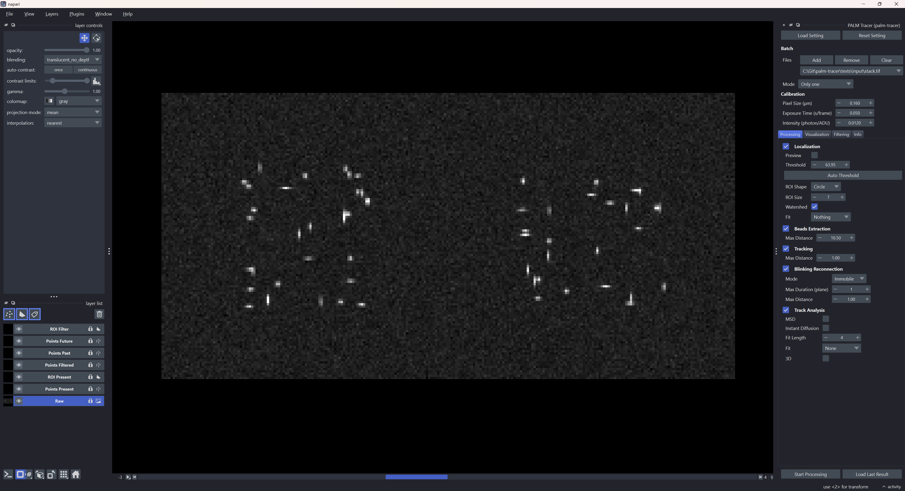
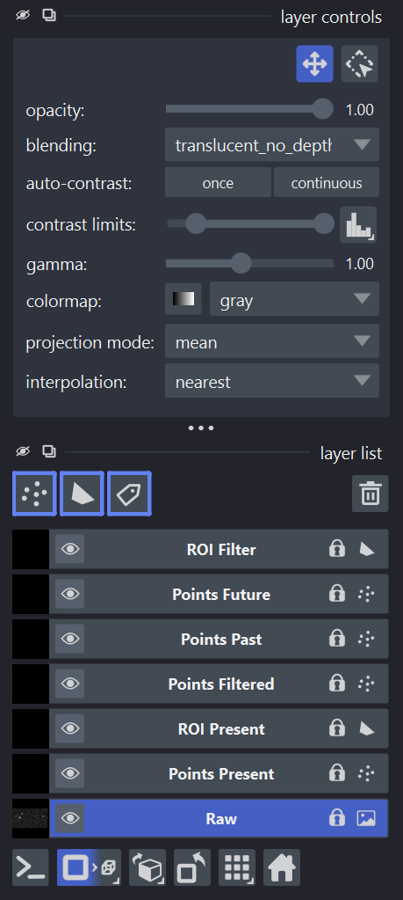
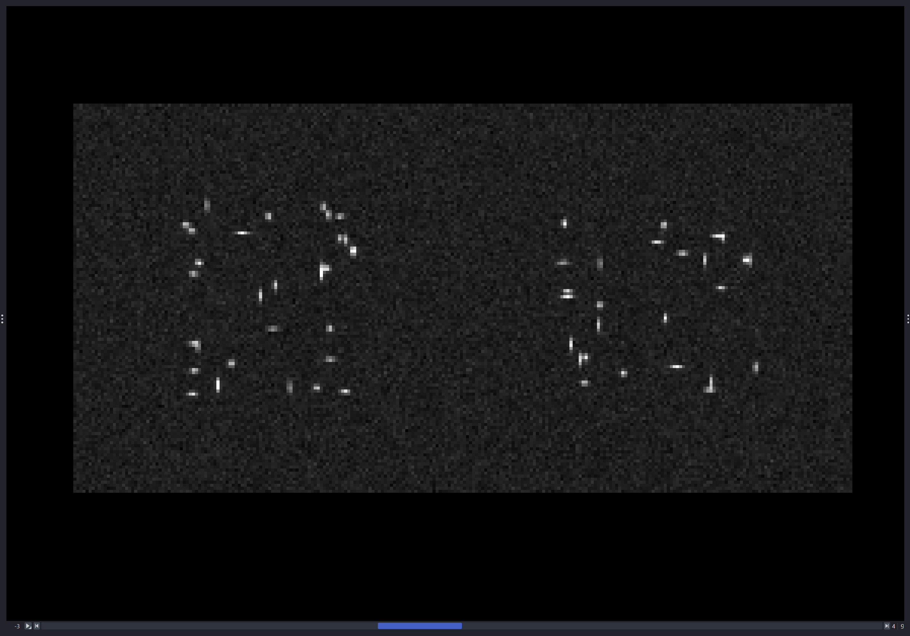
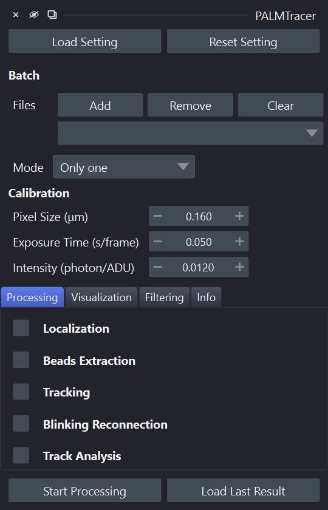
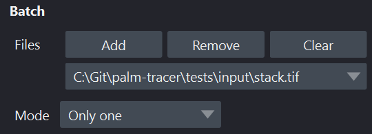
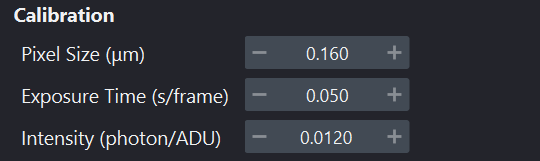
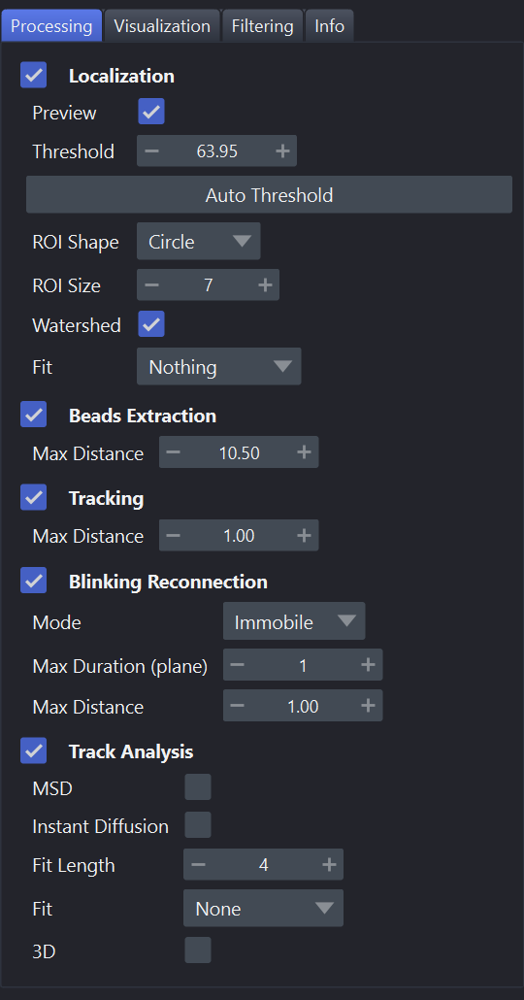
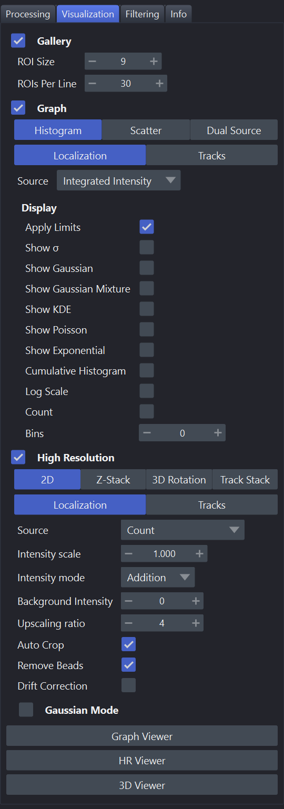
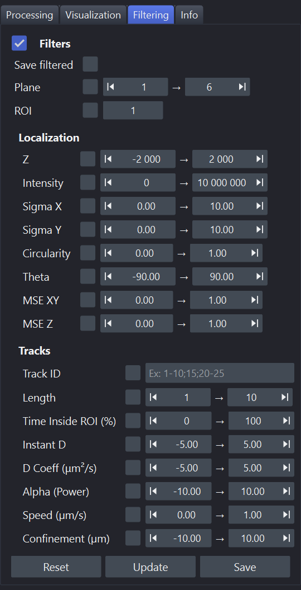
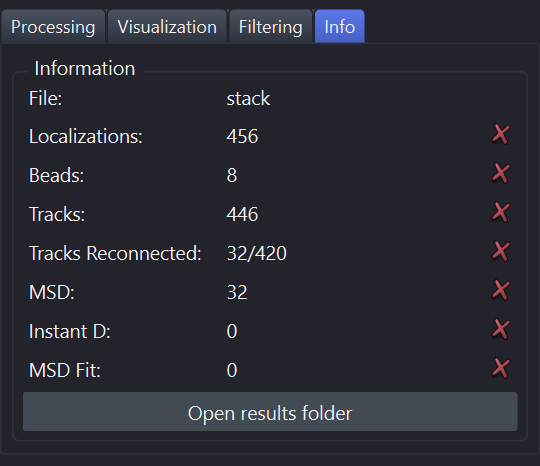

Manuel d'utilisation
=====================================

.. _manual_page:

.. role:: python(code)
   :language: python

PALM Tracer est un plugin Napari pour localiser des émetteurs, suivre des particules et explorer les résultats d'une acquisition.

Lancement
---------

Pour lancer Napari et ouvrir le widget principal, suivez les instructions de
:ref:`lancement de PALM Tracer <launch_palmtracer>`.

Organisation de l'interface
----------------------------------

L'interface Napari avec PALMTracer est organisée en trois volets principaux :

- À gauche : le panneau des calques (Layers)
- Au centre : la fenêtre de visualisation
- À droite : le widget PALMTracer

   Vue d'ensemble de Napari avec le widget PALMTracer

Volet des calques
^^^^^^^^^^^^^^^^^^^^^^^^^^^^^^^^^^

Le volet des calques permet de retrouver les éléments affichés par le widget.

- :guilabel:`Raw` contient l'image brute.
- :guilabel:`Points Past`, :guilabel:`Points Present` et :guilabel:`Points Future` montrent les détections retenues dans l'aperçu sur les trois plans.
- :guilabel:`Points Filtered` montre les détections écartées sur le plan courant.
- :guilabel:`ROI Present` trace les contours des fenêtres autour des détections retenues sur le plan courant.
- :guilabel:`ROI Filter` contient les :term:`zones d'intérêt <ROI (Region Of Interest)>` dessinées pour le filtrage.

Fonctionnalités principales :

- Afficher / masquer un calque
- Modifier la transparence
- Changer la palette de couleurs
- Réorganiser l'ordre des calques

   Volet calque de Napari

Volet de visualisation
^^^^^^^^^^^^^^^^^^^^^^^^^^^^^^^^^^

La zone centrale de Napari affiche les données. Vous pouvez :

- Zoomer (molette de la souris)
- Vous déplacer (clic gauche maintenu)
- Changer de :term:`plan <Plan (frame)>` via la barre de dimension
- Régler le contraste

PALMTracer met automatiquement à jour cette zone à chaque changement de fichier ou lors de l'aperçu.

   Volet de visualisation de Napari

Volet PALMTracer
^^^^^^^^^^^^^^^^^^^^^^^^^^^^^^^^^^

Le volet de droite contient le widget principal de PALMTracer.

En haut, :guilabel:`Load Setting` ouvre un fichier de paramètres JSON et :guilabel:`Reset Setting` rétablit les valeurs par défaut.
Les sections :guilabel:`Batch` et :guilabel:`Calibration` s'appliquent à l'ensemble du traitement.

- :guilabel:`Processing` règle la localisation, l'extraction des billes, le suivi, la reconnexion et l'analyse des trajectoires.
- :guilabel:`Visualization` configure les rendus automatiques et ouvre les visionneuses.
- :guilabel:`Filtering` règle les critères de sélection des localisations et des trajectoires.
- :guilabel:`Info` affiche le fichier courant et les résultats chargés en mémoire.

En bas, :guilabel:`Start Processing` lance le traitement. :guilabel:`Load Last Result` recharge les derniers résultats et les paramètres associés.

   Volet Widget de Napari

Ouverture de fichiers
----------------------------------

Dans :guilabel:`Batch`, cliquez sur :guilabel:`Add` ou déposez des fichiers :file:`.tif`, :file:`.tiff` ou :file:`.stk` dans Napari.
Le fichier sélectionné dans la liste s'affiche dans le calque :guilabel:`Raw`, au plan central. PALM Tracer cherche également les résultats déjà enregistrés.

Choisissez le :guilabel:`Mode` selon l'acquisition.

- :guilabel:`Only one` traite la pile sélectionnée.
- :guilabel:`Each File separately` traite chaque pile indépendamment.
- :guilabel:`All in One` concatène les piles dans l'ordre de la liste. Elles doivent avoir les mêmes dimensions X et Y.

:guilabel:`Remove` retire le fichier sélectionné de la liste. :guilabel:`Clear` vide la liste et rétablit le mode :guilabel:`Only one`.

   Paramètres de Batch

Calibration de l'acquisition
----------------------------------

Dans la section :guilabel:`Calibration`, renseignez :

- Taille de pixel en micromètres (µm).
- Temps d'exposition en secondes par image.
- Intensité lumineuse en photons par unités analogique-numériques (:term:`ADU <ADU (Analog-to-Digital Unit)>`).

Ces paramètres sont utilisés pour :

- Convertir les intensités brutes.
- Calibrer les trajectoires en unités physiques.
- Permettre des mesures physiques cohérentes, notamment pour le calcul des :term:`coefficients de diffusion <Coefficient de diffusion>`.

   Paramètres de Calibration

Onglet Processing
----------------------------------

Activez les étapes nécessaires à votre acquisition dans :guilabel:`Processing`.
:guilabel:`Beads Extraction` extrait les trajectoires des billes fiduciaires à partir des localisations.
Elles peuvent servir à corriger la dérive ou être exclues de la reconstruction haute résolution.

   Onglet Processing du Widget

Localisation
^^^^^^^^^^^^^^^^^^^^^^^^^^^^^^^^^^

La section *Localisation* permet de configurer les paramètres qui influencent directement la détection des molécules sur chaque image.

- :guilabel:`Preview` lance l'aperçu sur le plan courant et ses voisins.
- :guilabel:`Threshold` règle le :term:`seuil de détection <Seuil (Threshold)>`. :guilabel:`Auto Threshold` l':ref:`estime sur le plan courant <auto_threshold_page>`.
- :guilabel:`ROI Size` règle la taille de la fenêtre d'ajustement. :guilabel:`ROI Shape` règle la forme de son contour dans l'aperçu.
- :guilabel:`Watershed` aide à séparer les détections proches.
- :guilabel:`Fit` choisit la méthode d':ref:`ajustement <fit_page>`. Avec l'ajustement gaussien, l'option :guilabel:`3D` estime Z à partir d'un modèle d'astigmatisme.

Tracking
^^^^^^^^^^^^^^^^^^^^^^^^^^^^^^^^^^

La section *Tracking* est utilisée pour relier les détections entre plans afin de reconstruire des trajectoires (si votre acquisition est adaptée à cette analyse).

Dans :guilabel:`Tracking`, :guilabel:`Max Distance` fixe le déplacement maximal en pixels entre deux plans consécutifs.

Activez :guilabel:`Blinking Reconnection` pour :term:`reconnecter les segments <Reconnexion des trajectoires>`
interrompus par un :term:`scintillement <Scintillement>`. Choisissez le type de mouvement dans :guilabel:`Mode`
(:guilabel:`Immobile`, :guilabel:`Diffuse` ou :guilabel:`Linear`), puis réglez le nombre maximal de plans manquants
avec :guilabel:`Max Duration (plane)` et la distance maximale par plan en pixels avec :guilabel:`Max Distance`.

Le suivi est calculé lors du traitement complet.

Analyses des trajectoires
^^^^^^^^^^^^^^^^^^^^^^^^^^^^^^^^^^

Dans :guilabel:`Track Analysis`, choisissez le :term:`déplacement quadratique moyen <MSD (Mean Squared Displacement)>`
(:guilabel:`MSD`), la :term:`diffusion instantanée <Diffusion instantanée>` (:guilabel:`Instant Diffusion`)
ou un modèle de mouvement (:guilabel:`Fit`). :guilabel:`Fit Length` règle le nombre de retards temporels initiaux
du MSD utilisés pour l'ajustement. :guilabel:`3D` inclut la coordonnée Z dans les calculs.

.. _manual_visualization:

Onglet Visualization
----------------------------------

Activez :guilabel:`Gallery`, :guilabel:`Graph` ou :guilabel:`High Resolution` pour produire automatiquement une galerie de détections,
un graphique ou une reconstruction haute résolution pendant le traitement.

Pour explorer les résultats, ouvrez :guilabel:`Graph Viewer` (:ref:`graphiques <viewer_graph_page>`),
:guilabel:`HR Viewer` (:ref:`haute résolution <viewer_hr_page>`) ou :guilabel:`3D Viewer` (:ref:`localisations 3D <viewer_3d_page>`).

   Onglet Visualization du Widget

Onglet Filtering
----------------------------------

Activez le groupe :guilabel:`Filters`, puis cochez les critères à appliquer aux localisations ou aux trajectoires.
Pour ne retenir que les localisations d'une zone de l'image, dessinez un rectangle, une ellipse ou un polygone
sur le calque :guilabel:`ROI Filter`. Cochez :guilabel:`ROI` et choisissez le numéro de la forme. La zone sélectionnée apparaît en jaune.
Pour filtrer les trajectoires selon la proportion de leurs points dans cette zone, cochez :guilabel:`Time Inside ROI (%)` et réglez ses bornes.
Ce critère conserve aussi les points situés hors de la zone sur les trajectoires retenues.

L'aperçu de localisation tient compte des critères au fur et à mesure. Pour appliquer les filtres aux résultats déjà chargés, cliquez sur :guilabel:`Update`.
Chaque mise à jour repart des résultats filtrés s'ils sont disponibles. Pour élargir une sélection, utilisez :guilabel:`Reset`, puis réactivez les critères voulus.
:guilabel:`Reset` désactive les filtres et vide les résultats filtrés en mémoire. :guilabel:`Save` enregistre les tableaux filtrés disponibles.
Activez :guilabel:`Save filtered` pour les enregistrer lors du traitement ou de l'application des filtres.

   Onglet Filtering du Widget

Onglet Info
-----------

:guilabel:`File` indique la pile courante. Les autres lignes comptent les localisations, les billes, les trajectoires
avant et après reconnexion et les trajectoires pour lesquelles chaque analyse est disponible.
Un compteur comme ``32/420`` indique que 32 résultats sur 420 sont conservés après filtrage.
Survolez ce compteur pour voir les pourcentages de résultats conservés et écartés.

La croix rouge retire de la mémoire les résultats de sa ligne, y compris leur version filtrée.
Les fichiers déjà enregistrés restent disponibles dans l'explorateur via :guilabel:`Open results folder`.

   Onglet Info

Ordre des traitements
---------------------

Le :ref:`pipeline de traitement <pipeline_page>` décrit les étapes exécutées par :guilabel:`Start Processing`,
la réutilisation des résultats et les fichiers produits.
