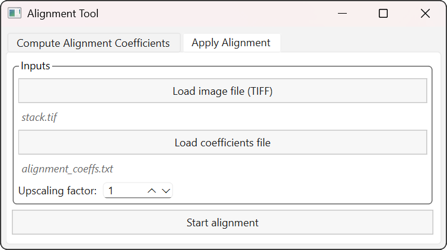

Outil d'alignement
==============================

.. _tool_alignment_page:

.. role:: console(code)
   :language: console

L'outil applique des coefficients existants pour aligner une pile TIFF.

Lancement
---------

Dans Napari, ouvrez :menuselection:`Plugins --> PALM Tracer --> Alignment Tool`.

Organisation de l'interface
----------------------------------

L'outil est organisé en deux onglets correspondant aux deux étapes principales du workflow.

.. note::

   Faites un clic droit dans une zone libre du panneau de commandes et cochez :guilabel:`Always on top` pour garder la fenêtre au premier plan.
   Si le panneau est ancré dans Napari, détachez-le d'abord.

.. list-table::
   :align: center
   :widths: 50 50
   :class: image-grid

   * - .. figure:: ../_static/img/tool_align/tab_1.png
          :figclass: centered-caption
          :alt: Onglet 1 : Calcul des coefficients d'alignement
          :width: 95%

          Onglet 1 : Calcul des coefficients d'alignement

     - .. figure:: ../_static/img/tool_align/tab_2.png
          :figclass: centered-caption
          :alt: Onglet 2 : Alignement
          :width: 95%

          Onglet 2 : Alignement

Calcul des coefficients
-----------------------

L'onglet :guilabel:`Compute Alignment Coefficients` est prévu pour calculer les coefficients à partir d'une image
avec les deux vues côte à côte. Le bouton de calcul est désactivé dans cette version.

Alignement d'une pile
----------------------------------------------------------------

Dans :guilabel:`Apply Alignment`, chargez la pile avec :guilabel:`Load image file (TIFF)` et les coefficients avec :guilabel:`Load coefficients file`.

.. note:: Le format actuellement pris en charge correspond à celui de MetaMorph : un fichier texte contenant une ligne d'en-tête suivie de deux lignes de 10 valeurs.

Survolez le nom d'un fichier chargé pour afficher son chemin complet.

   Interface d'alignement d'une pile.

:guilabel:`Upscaling factor` règle le suréchantillonnage du TIFF de sortie.

.. important::
   | L'agrandissement modifie la résolution spatiale des données :
   | la taille de pixel est divisée par le facteur d'agrandissement, par exemple, **100 nm/pixel** devient **50 nm/pixel** avec un facteur de 2.
   | Pensez à mettre à jour vos paramètres de calibration pour les traitements ultérieurs.

L'appui sur le bouton :guilabel:`Start alignment` lance le calcul d'alignement.
Un nouveau fichier TIFF est généré dans le même dossier que le fichier d'origine, avec le suffixe :file:`_aligned`. Exemple : :file:`stack.tif` → :file:`stack_aligned.tif`.

Le fichier original n'est **pas modifié**.
