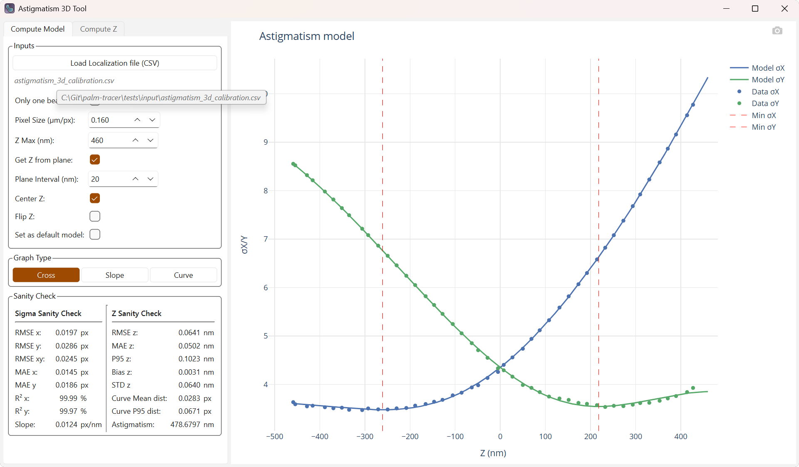
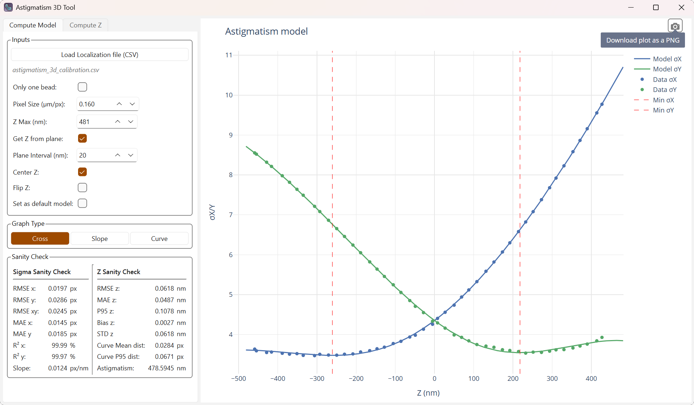
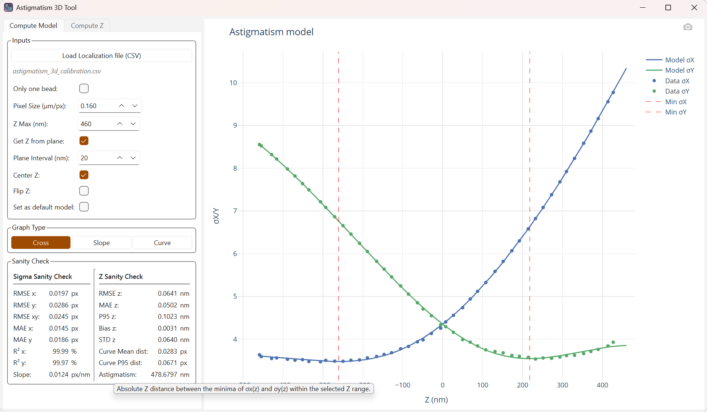
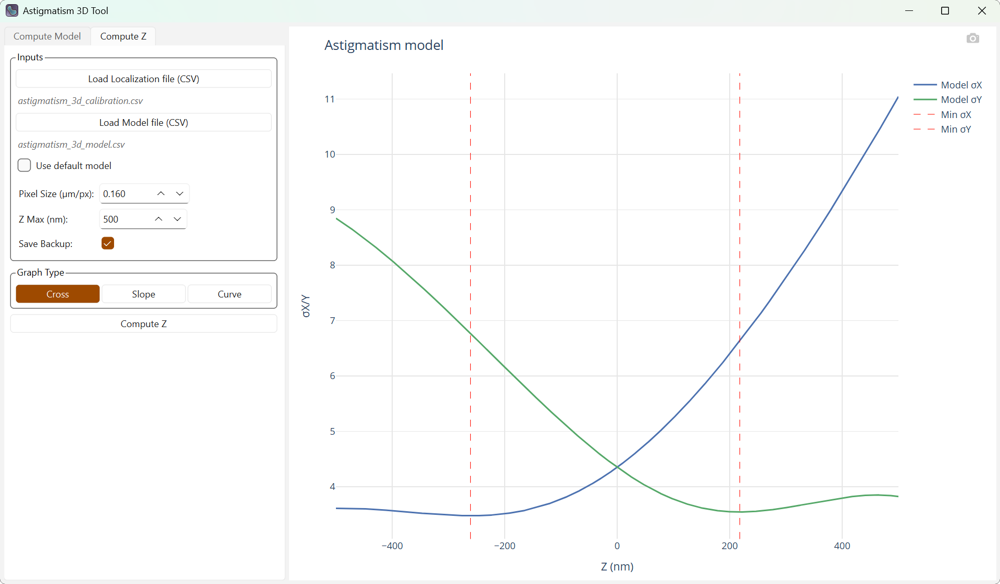

Outil d'astigmatisme 3D
==============================

.. _tool_astig_page:

.. |camera| image:: /_static/img/Camera.svg
   :height: 1.2em
   :alt: Appareil photo

L'outil **Astigmatism 3D Tool** calibre un modèle d':term:`astigmatisme <Astigmatisme 3D>` et estime la position axiale Z à partir des largeurs de la :term:`PSF <PSF (Point Spread Function)>` (:math:`\sigma_x` et :math:`\sigma_y`).

Lancement
---------

Dans Napari, ouvrez :menuselection:`Plugins --> PALM Tracer --> Astigmatism 3D Tool`.

Organisation de l'interface
----------------------------------

L'onglet :guilabel:`Compute Model` calibre le modèle et l'onglet :guilabel:`Compute Z` l'applique à un fichier de localisations.

.. note::

   Faites un clic droit dans une zone libre du panneau de commandes et cochez :guilabel:`Always on top` pour garder la fenêtre au premier plan.
   Si le panneau est ancré dans Napari, détachez-le d'abord.

.. list-table::
   :align: center
   :widths: 50 50
   :class: image-grid

   * - .. figure:: ../_static/img/tool_astig/tab_1.png
          :figclass: centered-caption
          :alt: Onglet 1 : Calcul du modèle.
          :width: 60%

          Onglet 1 : Calcul du modèle.

     - .. figure:: ../_static/img/tool_astig/tab_2.png
          :figclass: centered-caption
          :alt: Onglet 2 : Estimation de la position axiale (Z)
          :width: 60%

          Onglet 2 : Estimation de la position axiale (Z)

Calcul du modèle
----------------

Dans :guilabel:`Compute Model`, utilisez :guilabel:`Load Localization file (CSV)` pour ouvrir le fichier de calibration.
Le fichier doit contenir les colonnes ``Sigma X``, ``Sigma Y`` et ``Z``. Renseignez :guilabel:`Pixel Size (nm/px)` et :guilabel:`Z Max (nm)`.

   Affichage du chemin complet du fichier.

Pour déduire Z de la colonne ``Plane``, activez :guilabel:`Get Z from plane` et renseignez le pas d'acquisition dans :guilabel:`Plane Interval (nm)`.
Décochez cette option pour utiliser les valeurs de la colonne ``Z``.
:guilabel:`Flip Z` permet d'inverser le signe de Z selon le sens du balayage, de haut en bas ou de bas en haut.
:guilabel:`Center Z` place l'origine près du croisement des deux courbes de largeur. Si Z est déduit des plans, le recentrage est automatique et la case est masquée.
Activez :guilabel:`Only one bead` si la calibration ne comporte qu'une bille et que plusieurs points sont détectés sur certains plans.

Le modèle est recalculé au chargement et lors des changements de paramètres.
Il est enregistré dans :file:`astigmatism_3d_model.csv`, à côté du CSV de calibration.
:guilabel:`Set as default model` l'enregistre aussi comme modèle par défaut dans le dossier de configuration de l'utilisateur.

Graphiques et export
^^^^^^^^^^^^^^^^^^^^

Choisissez une représentation du modèle dans :guilabel:`Graph Type`.

.. list-table::
   :align: center
   :widths: 1 1 1
   :class: image-grid

   * - .. figure:: ../_static/img/tool_astig/curve_1.png
          :figclass: centered-caption
          :alt: Cross, courbes des deux largeurs de PSF en fonction de Z
          :width: 95%

          :guilabel:`Cross`

     - .. figure:: ../_static/img/tool_astig/curve_2.png
          :figclass: centered-caption
          :alt: Slope, différence entre les deux largeurs de PSF en fonction de Z
          :width: 95%

          :guilabel:`Slope`

     - .. figure:: ../_static/img/tool_astig/curve_3.png
          :figclass: centered-caption
          :alt: Curve, largeur selon Y en fonction de la largeur selon X, colorée par Z
          :width: 95%

          :guilabel:`Curve`

- :guilabel:`Cross` montre :math:`\sigma_x` et :math:`\sigma_y` en fonction de Z. Les repères verticaux rouges en pointillés indiquent la position de leurs minima sur l'axe Z.
- :guilabel:`Slope` montre la différence :math:`\sigma_x - \sigma_y` en fonction de Z.
- :guilabel:`Curve` trace :math:`\sigma_y` en fonction de :math:`\sigma_x`. La couleur indique Z.

Les points de calibration se superposent au modèle dans les vues :guilabel:`Cross` et :guilabel:`Slope` lorsqu'ils sont disponibles.

Cliquez sur l'icône |camera| en haut à droite du graphique pour l'exporter rapidement en PNG.

   Export de la figure en PNG.

Le bouton :guilabel:`Export figure` ouvre une boîte de dialogue où choisir le format de la figure affichée.
Les formats disponibles sont PNG, SVG (vectoriel), WebP, HTML (interactif) et PDF.

Contrôle du modèle
^^^^^^^^^^^^^^^^^^

Après le calcul, :guilabel:`Sigma Sanity Check` résume l'ajustement des largeurs de PSF et
:guilabel:`Z Sanity Check` présente les erreurs axiales et la distance à la courbe.
La mesure :guilabel:`Astigmatism` donne l'écart axial entre les deux minima repérés dans :guilabel:`Cross`.

Survolez une métrique pour afficher sa définition.

   Affichage des explications des métriques de sanity check.

Estimation de la position axiale (Z)
------------------------------------

Dans :guilabel:`Compute Z`, utilisez :guilabel:`Load Localization file (CSV)` pour charger les localisations à traiter.
Sélectionnez le modèle avec :guilabel:`Load Model file (CSV)` ou cochez :guilabel:`Use default model` pour utiliser le modèle enregistré par défaut.
Vérifiez :guilabel:`Pixel Size (nm/px)` et :guilabel:`Z Max (nm)`, puis cliquez sur :guilabel:`Compute Z`.

Le calcul réécrit le CSV avec les colonnes ``Z`` et ``MSE Z`` mises à jour.
Laissez :guilabel:`Save Backup` coché pour conserver une copie du CSV avant l'écriture dans un sous-dossier :file:`backup`.

   Interface d'estimation de la position axiale (Z).
