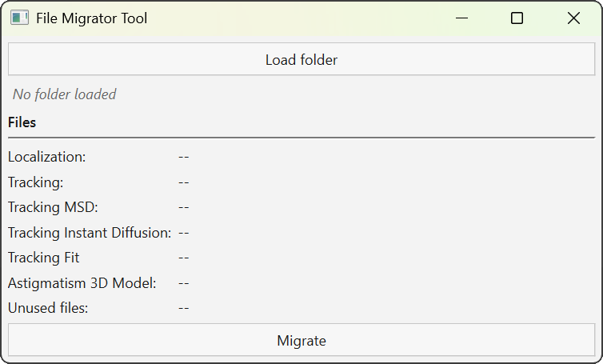
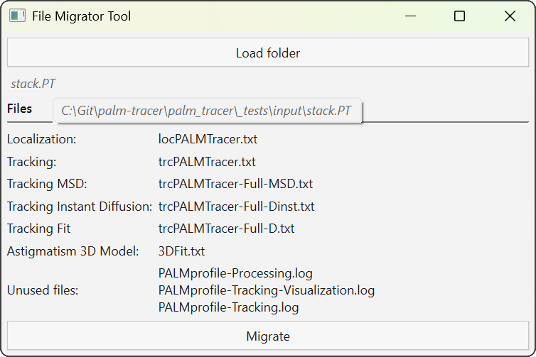

Outil de migration de fichiers
==============================

.. _tool_fm_page:

Le **File Migrator Tool** convertit les résultats PALM Tracer de MetaMorph en fichiers CSV utilisables dans Napari.

Dans Napari, ouvrez :menuselection:`Plugins --> PALM Tracer --> File Migrator Tool`.

.. note::

   Faites un clic droit dans une zone libre du panneau de commandes et cochez :guilabel:`Always on top` pour garder la fenêtre au premier plan.
   Si le panneau est ancré dans Napari, détachez-le d'abord.

   Interface de l'outil de migration de fichiers.

Convertir un dossier de résultats
---------------------------------

1. Sélectionnez un dossier MetaMorph se terminant par :file:`.PT` avec :guilabel:`Load folder` ou déposez-le dans la fenêtre.
2. Vérifiez la liste des fichiers détectés. La rubrique :guilabel:`Unused files` indique ceux qui sont ignorés.
3. Cliquez sur :guilabel:`Migrate`. Pour un dossier source :file:`mon_experience.PT`, les CSV sont écrits dans le dossier voisin :file:`mon_experience_PALM_Tracer`. Les fichiers d'origine sont conservés.

Survolez le nom du dossier pour afficher son chemin complet.

   Affichage du chemin complet du dossier.

Fichiers pris en charge
-----------------------

- :term:`Localisations <Localisation>` (:file:`locPALMTracer.txt`)
- :term:`Trajectoires <Trajectoire>` (:file:`trcPALMTracer.txt`)
- Analyses des trajectoires (:file:`trcPALMTracer-Full-D.txt`, :file:`trcPALMTracer-Full-Dinst.txt`, :file:`trcPALMTracer-Full-MSD.txt`)
- Modèle d':term:`astigmatisme 3D <Astigmatisme 3D>` (:file:`3DFit.txt`)
