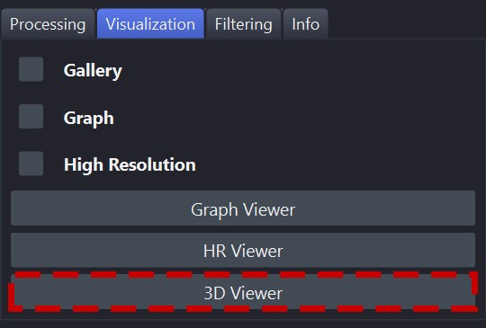
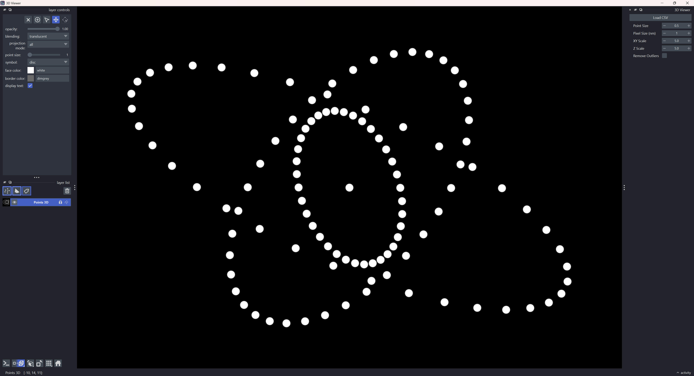
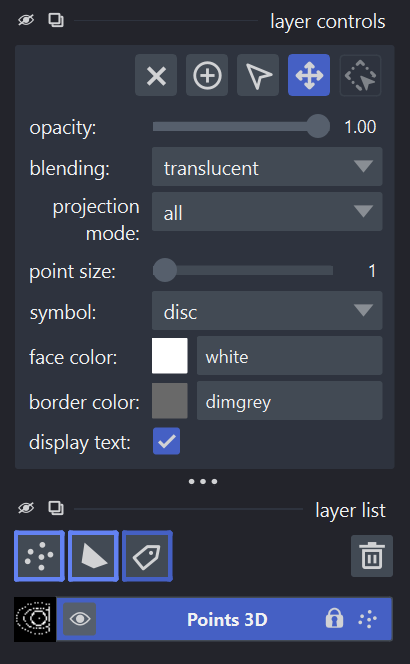
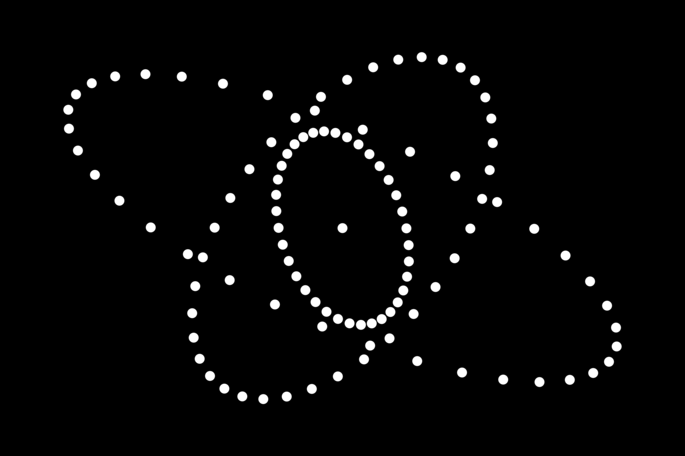
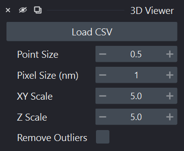
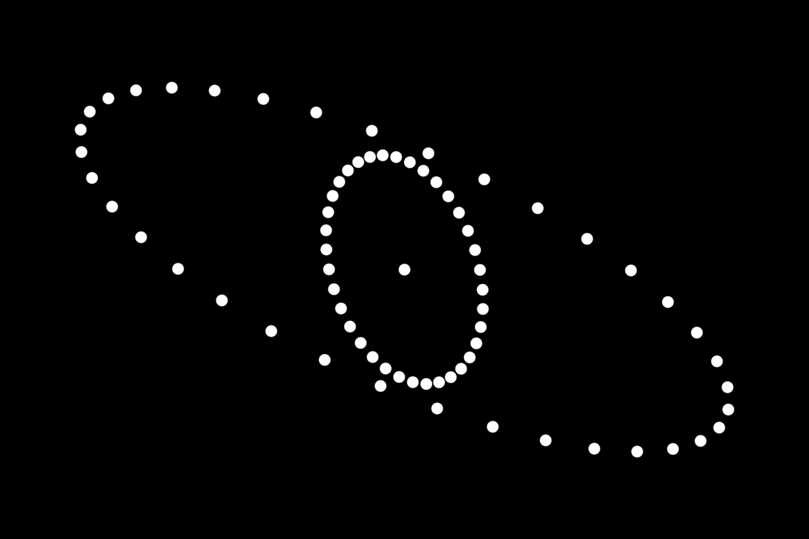
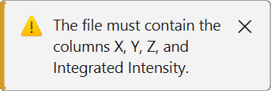

Visionneuse 3D
==============================

.. _viewer_3d_page:

La visionneuse affiche en trois dimensions des localisations déjà calculées.

Lancement
---------

Dans l':ref:`onglet Visualization <manual_visualization>` de PALM Tracer, cliquez sur :guilabel:`3D Viewer`.
Vous pouvez aussi ouvrir la visionneuse depuis :menuselection:`Plugins --> PALM Tracer --> 3D Viewer`.

   Bouton de lancement de la visionneuse

Organisation de l'interface
----------------------------------

   Vue d'ensemble de Napari avec le widget Viewer 3D

Volet des calques
^^^^^^^^^^^^^^^^^^^^^^^^^^^^^^^^^^

   Calque Points 3D

À gauche, le calque :guilabel:`Points 3D` permet de modifier l'opacité, le symbole et la couleur des points.

Volet de visualisation
^^^^^^^^^^^^^^^^^^^^^^^^^^^^^^^^^^

   Volet de visualisation de Napari

Dans la vue centrale, utilisez la molette pour zoomer et maintenez le clic gauche en déplaçant la souris pour faire pivoter le nuage de points.

Ouverture des fichiers
----------------------------------

Dans le panneau à droite, cliquez sur :guilabel:`Load CSV` ou déposez un fichier de localisations CSV dans la fenêtre.
Le fichier doit contenir les colonnes ``X`` et ``Y`` en pixels, ``Z`` en nanomètres et ``Integrated Intensity``.

Options de visualisation
----------------------------

   Options de visualisation

- :guilabel:`Point Size` règle le diamètre des points en nanomètres dans la vue.
- Renseignez :guilabel:`Pixel Size (nm)` avec la taille d'un pixel de l'acquisition. La visionneuse s'en sert pour convertir X et Y en nanomètres.
- :guilabel:`XY Scale` et :guilabel:`Z Scale` multiplient les coordonnées à l'affichage. Laissez les deux facteurs à 1 pour conserver l'échelle physique.
- :guilabel:`Remove Outliers` affiche uniquement les points dont l'intensité intégrée est strictement positive. Vous pouvez décocher l'option pour réafficher tous les points.

   Affichage après filtrage par intensité intégrée

Messages de l'application
----------------------------

Si le CSV ne contient pas les quatre colonnes attendues, Napari affiche cet avertissement.

   Notification Napari

.. code-block:: console

   The file must contain the columns X, Y, Z, and Integrated Intensity.
