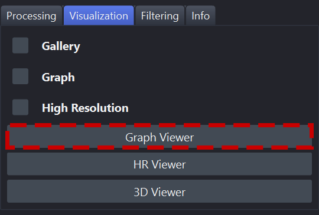
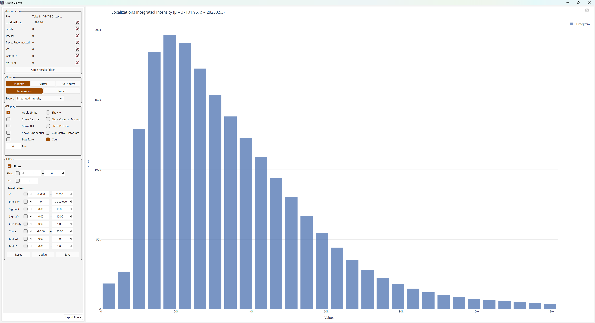
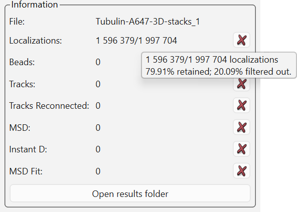
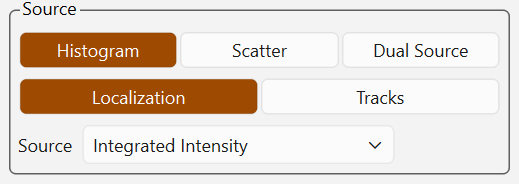
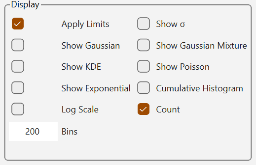
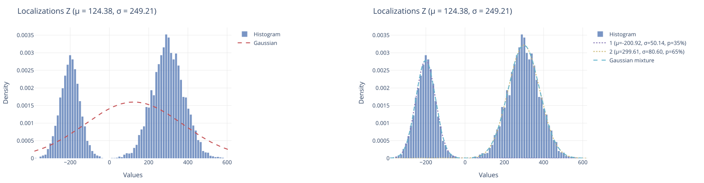
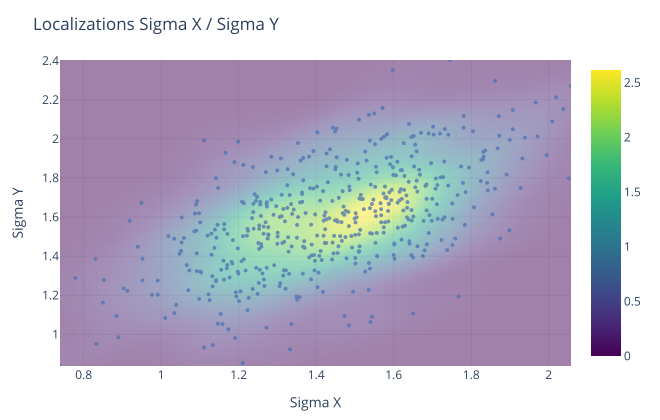
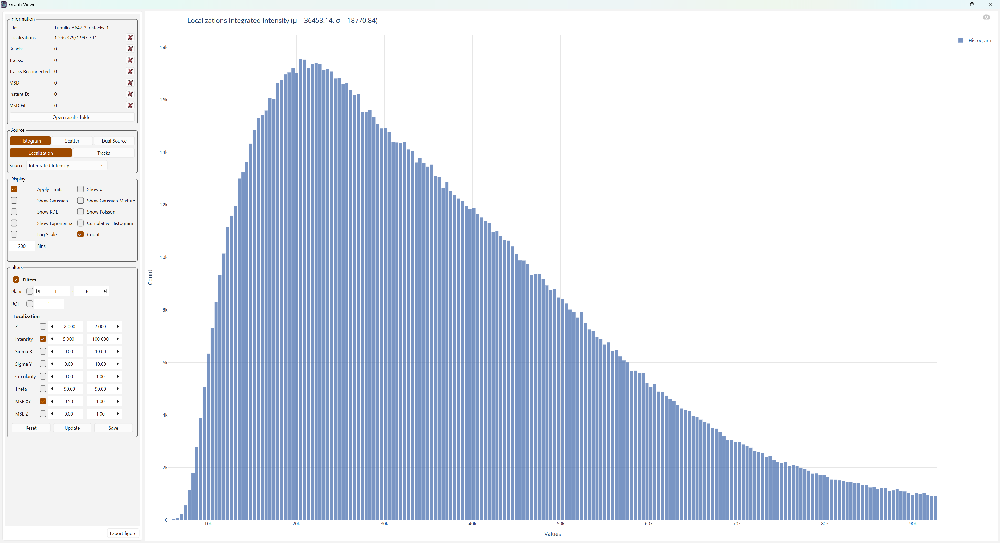

Visionneuse de graphiques
=========================

.. _viewer_graph_page:

.. |camera| image:: /_static/img/Camera.svg
   :height: 1.2em
   :alt: Appareil photo

Lancement
---------

Dans l'onglet :guilabel:`Visualization` de PALM Tracer, cliquez sur :guilabel:`Graph Viewer`.
Vous pouvez aussi ouvrir la visionneuse depuis :menuselection:`Plugins --> PALM Tracer --> Graph Viewer`.

   Bouton de lancement de la visionneuse

Organisation de l'interface
---------------------------

À gauche, les groupes :guilabel:`Information`, :guilabel:`Source`, :guilabel:`Display` et :guilabel:`Filters` donnent accès aux réglages.
À droite, le graphique interactif se met à jour quand les options ou les résultats changent. Survolez le tracé pour lire les valeurs.

.. note::

   Faites un clic droit dans une zone libre du panneau de commandes et cochez :guilabel:`Always on top` pour garder la fenêtre au premier plan.
   Si le panneau est ancré dans Napari, détachez-le d'abord.

   Graph Viewer en mode :guilabel:`Histogram`

Charger des résultats
---------------------

Déposez une pile :file:`.tif`, :file:`.tiff` ou :file:`.stk` dans la fenêtre pour charger ses derniers résultats enregistrés.
Lorsque la visionneuse est ouverte depuis le widget principal, le dépôt ajoute aussi la pile à son :guilabel:`Batch`.

Le groupe :guilabel:`Information` affiche la pile courante et les compteurs de résultats.
Survolez un compteur pour consulter le détail du filtrage. :guilabel:`Open results folder` ouvre le dossier sur disque.
Le :doc:`manuel <manual>` détaille les compteurs et les actions de ce panneau dans la section **Onglet Info**.

   Détail du filtrage des localisations au survol

Choisir quoi tracer
-------------------

Dans :guilabel:`Source`, choisissez le mode, puis :guilabel:`Localization` ou :guilabel:`Tracks` et la grandeur à tracer.
La liste des sources dépend du mode et de la famille de données. Les grandeurs issues d'une analyse nécessitent les résultats correspondants.

   Choix du mode, du type de données et de la grandeur à tracer

.. list-table::
   :header-rows: 1
   :widths: 20 42 38

   * - Mode
     - Ce que montre le graphique
     - Exemple
   * - :guilabel:`Histogram`
     - La distribution d'une grandeur.
     - Les positions :guilabel:`Z` des localisations.
   * - :guilabel:`Scatter`
     - Des valeurs tracées au fil des plans, des retards temporels ou des fenêtres d'analyse, selon la source.
     - :guilabel:`Count per Plane` pour suivre le nombre de localisations au fil de l'acquisition.
   * - :guilabel:`Dual Source`
     - La relation entre deux grandeurs mesurées sur les mêmes localisations ou trajectoires.
     - :guilabel:`Sigma X` et :guilabel:`Sigma Y` sur un nuage de points. :guilabel:`Show KDE` ajoute une carte de densité.

Les trois exemples ci-dessous utilisent des données simulées.

.. list-table::
   :align: center
   :widths: 33 34 33
   :class: image-grid

   * - .. figure:: ../_static/img/viewer_graph/mode_histogram.svg
          :figclass: centered-caption
          :alt: Histogramme des positions Z, avec deux pics.
          :width: 100%

          :guilabel:`Histogram`

     - .. figure:: ../_static/img/viewer_graph/mode_scatter.svg
          :figclass: centered-caption
          :alt: Nombre de localisations par plan au cours de l'acquisition.
          :width: 100%

          :guilabel:`Scatter`

     - .. figure:: ../_static/img/viewer_graph/mode_dual_source.svg
          :figclass: centered-caption
          :alt: Nuage de points comparant Sigma X et Sigma Y.
          :width: 100%

          :guilabel:`Dual Source`

Avec :guilabel:`Tracks` en mode :guilabel:`Histogram`, la source :guilabel:`MSD` permet de choisir le retard temporel dans :guilabel:`MSD Step`, en plans.
En mode :guilabel:`Scatter`, :guilabel:`MSD Mean` montre la moyenne des trajectoires en fonction de ce retard.

Options d'affichage
-------------------

Dans :guilabel:`Display`, les options disponibles dépendent du mode.

- :guilabel:`Count` affiche des effectifs. Décochez-le pour afficher une densité.
- :guilabel:`Bins` règle les classes de l'histogramme. Saisissez ``-1`` pour obtenir des classes de largeur 1, centrées sur les entiers pour des données entières.
  Avec ``0``, le nombre de classes est automatique. Une valeur positive fixe leur nombre. Les sources de longueur de trajectoire imposent les classes de largeur 1.
- :guilabel:`Cumulative Histogram` cumule les valeurs de classe en classe.
- :guilabel:`Apply Limits` restreint les valeurs tracées à trois écarts-types de part et d'autre de la moyenne. :guilabel:`Show σ` ajoute des repères à la moyenne et à un, deux et trois écarts-types de celle-ci.
- :guilabel:`Log Scale` applique un logarithme en base 10 aux valeurs positives. Les valeurs nulles ou négatives sont écartées du tracé.

   Réglages d'affichage d'un histogramme

.. list-table::
   :align: center
   :widths: 50 50
   :class: image-grid

   * - .. figure:: ../_static/img/viewer_graph/bins_0.png
          :figclass: centered-caption
          :alt: Histogramme des intensités intégrées avec des barres plus larges et un nombre de classes choisi automatiquement.
          :width: 100%

          Nombre de classes choisi automatiquement (:guilabel:`Bins` = ``0``)

     - .. figure:: ../_static/img/viewer_graph/bins_200.png
          :figclass: centered-caption
          :alt: Même histogramme avec des barres plus fines et un nombre de classes fixé à 200.
          :width: 100%

          Nombre de classes fixé à 200 (:guilabel:`Bins` = ``200``)

Courbes et distributions
^^^^^^^^^^^^^^^^^^^^^^^^

En mode :guilabel:`Histogram`, vous pouvez superposer ces courbes aux barres.

- :guilabel:`Show Gaussian` affiche la gaussienne calculée à partir de la moyenne et de l'écart-type.
- :guilabel:`Show Gaussian Mixture` ajuste deux gaussiennes et affiche leurs contributions ainsi que leur somme.
- :guilabel:`Show KDE` affiche une estimation lissée de la densité à partir des données.
- :guilabel:`Show Poisson` superpose une loi de Poisson, adaptée aux comptages.
- :guilabel:`Show Exponential` superpose une loi exponentielle, par exemple pour des durées.

Exemple avec deux populations en Z
^^^^^^^^^^^^^^^^^^^^^^^^^^^^^^^^^^

L'histogramme montre des localisations simulées à deux profondeurs. À gauche, la gaussienne unique place son maximum entre les deux pics.
À droite, le mélange suit les deux pics. Il permet ici de décrire séparément les deux populations.

   Deux populations simulées en Z (35 % / 65 %). Les axes et les classes de l'histogramme sont identiques.

Exemple de carte de densité en Dual Source
^^^^^^^^^^^^^^^^^^^^^^^^^^^^^^^^^^^^^^^^^^^

Dans le nuage :guilabel:`Sigma X` / :guilabel:`Sigma Y`, certains points se superposent. En mode :guilabel:`Dual Source`,
activez :guilabel:`Show KDE` pour visualiser leur concentration. Le jaune indique les zones de plus forte densité, et le violet celles de plus faible densité.

   Le nuage de points des exemples ci-dessus avec sa carte de densité.

Filtrer les résultats
---------------------

Activez le groupe :guilabel:`Filters`, cochez les critères voulus et cliquez sur :guilabel:`Update`.
La figure et les compteurs se mettent à jour. Lorsque la visionneuse partage les résultats du widget principal, les filtres s'y appliquent également.
:guilabel:`Update` repart des résultats filtrés s'ils sont disponibles. Pour élargir la sélection, cliquez sur :guilabel:`Reset` pour effacer les résultats filtrés, puis réactivez les critères voulus.

Pour reconstruire des trajectoires à partir de localisations filtrées, relancez le traitement avec les critères actifs dans le widget principal.

   Localisations filtrées selon l'intensité intégrée et la qualité de l'ajustement en XY (:guilabel:`XY Quality`)

Export
------

Cliquez sur l'icône |camera| en haut à droite du graphique pour l'exporter rapidement en PNG.

Le bouton :guilabel:`Export figure` ouvre une boîte de dialogue où choisir le format de la figure affichée.
Les formats disponibles sont PNG, SVG (vectoriel), WebP, HTML (interactif) et PDF.
