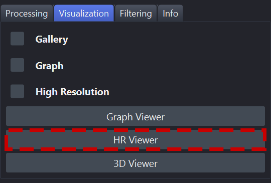
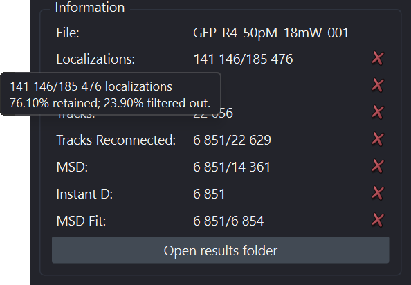
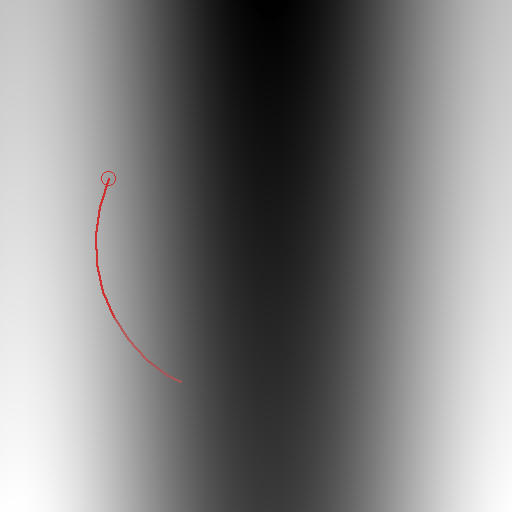

Visionneuse haute résolution
==============================

.. _viewer_hr_page:

Lancement
---------

Dans l'onglet :guilabel:`Visualization` de PALM Tracer, cliquez sur :guilabel:`HR Viewer`.
Vous pouvez aussi ouvrir la visionneuse depuis :menuselection:`Plugins --> PALM Tracer --> HR Viewer`.

   Bouton de lancement de la visionneuse

Organisation de l'interface
---------------------------

À gauche, sélectionnez les calques à afficher. :guilabel:`Visualization` contient l'image reconstruite.
Au centre, zoomez, ajustez le contraste ou parcourez les plans avec le curseur de dimensions de Napari.
À droite, :guilabel:`Information` indique les résultats chargés, :guilabel:`Source` configure la reconstruction et :guilabel:`Filters` règle la sélection.

Calques et points filtrés
^^^^^^^^^^^^^^^^^^^^^^^^^

En mode :guilabel:`2D` avec des localisations filtrées et des billes extraites, affichez :guilabel:`Points`, :guilabel:`Points Filtered` et :guilabel:`Beads`.
Par défaut, les localisations retenues sont en vert, les localisations écartées en rouge et les billes fiduciaires en orange.
Pour afficher les trajectoires, utilisez le calque :guilabel:`Tracks`.

.. list-table::
   :align: center
   :widths: 32 68
   :class: image-grid

   * - .. figure:: ../_static/img/viewer_hr/layers.png
          :figclass: centered-caption
          :alt: Capture du panneau des calques du HR Viewer à venir.
          :width: 100%

          Panneau des calques

     - .. figure:: ../_static/img/viewer_hr/layers_viz.png
          :figclass: centered-caption
          :alt: Vue agrandie des localisations retenues, écartées et d'une bille fiduciaire à venir.
          :width: 100%

          Localisations retenues, localisations écartées et bille fiduciaire

Ouvrir des résultats
--------------------

La visionneuse ouverte depuis PALM Tracer partage les résultats du widget principal. Vous pouvez aussi déposer une pile
:file:`.tif`, :file:`.tiff` ou :file:`.stk` dans sa fenêtre pour charger les derniers résultats enregistrés pour cette pile.

Survolez les compteurs de :guilabel:`Information` pour consulter le détail du filtrage. :guilabel:`Open results folder` ouvre le dossier sur disque.

   Détail du filtrage des localisations au survol

Choisir le rendu
----------------

Dans le groupe :guilabel:`Source`, choisissez un mode dans :guilabel:`Dimension`. En :guilabel:`2D`, choisissez aussi :guilabel:`Localization` ou :guilabel:`Tracks`.
La liste :guilabel:`Source` détermine la grandeur à représenter.
Par exemple, :guilabel:`Count` compte les localisations par pixel du rendu et :guilabel:`Track ID` distingue les trajectoires par leur identifiant.

.. list-table::
   :header-rows: 1
   :widths: 23 20 57

   * - Mode
     - Données
     - Résultat
   * - :guilabel:`2D`
     - Localisations ou trajectoires
     - Une image dans le plan XY.
   * - :guilabel:`Z-Stack`
     - Localisations avec Z
     - Une pile de coupes en profondeur. :guilabel:`Z Step (nm)` fixe l'écart entre les plans.
   * - :guilabel:`3D Rotation`
     - Localisations avec Z
     - Une suite de projections d'un tour complet. :guilabel:`Axis` choisit l'axe et :guilabel:`Frames` le nombre d'images du tour.
   * - :guilabel:`Track Stack`
     - Trajectoires
     - Une animation par plan de l'acquisition. Réglez la tête et la traînée avec :guilabel:`Head Size`, :guilabel:`Tail Width` et :guilabel:`Tail Length`. :guilabel:`Raw in Background` montre l'image brute en fond.

Les trois premiers rendus utilisent le même atome simulé avec :guilabel:`Gaussian Mode`. Le mode :guilabel:`Track Stack` suit une trajectoire simulée en spirale.

.. list-table::
   :align: center
   :widths: 50 50
   :class: image-grid

   * - .. figure:: ../_static/img/viewer_hr/atom_2d.png
          :figclass: centered-caption
          :alt: Atome simulé en 2D. Les localisations forment des anneaux concentriques dans le plan XY.
          :width: 100%

          :guilabel:`2D`

     - .. figure:: ../_static/img/viewer_hr/atom_z_stack.png
          :figclass: centered-caption
          :alt: Coupe centrale de l'atome simulé. Les anneaux extérieurs sont moins visibles que dans le rendu 2D.
          :width: 100%
          :target: ../_static/img/viewer_hr/atom_z_stack.gif

          :guilabel:`Z-Stack`

   * - .. figure:: ../_static/img/viewer_hr/atom_rotation_3d.png
          :figclass: centered-caption
          :alt: Projection oblique de l'atome simulé pendant la rotation.
          :width: 100%
          :target: ../_static/img/viewer_hr/atom_rotation_3d.gif

          :guilabel:`3D Rotation`

     - .. figure:: ../_static/img/viewer_hr/track_stack.png
          :figclass: centered-caption
          :alt: Trajectoire en spirale avec une tête circulaire claire et une traînée qui s'estompe.
          :width: 100%
          :target: ../_static/img/viewer_hr/track_stack.gif

          :guilabel:`Track Stack`

Trajectoires sur fond brut
^^^^^^^^^^^^^^^^^^^^^^^^^^

En mode :guilabel:`Track Stack`, activez :guilabel:`Raw in Background` pour superposer les trajectoires aux images d'origine.
Choisissez une palette dans :guilabel:`Color Map` pour distinguer les trajectoires sur le fond, puis cliquez sur :guilabel:`Generate`.

   La même spirale sur un fond brut simulé

Réglages et filtrage
--------------------

- :guilabel:`Upscaling ratio` règle le nombre de pixels du rendu par pixel d'acquisition sur chaque axe XY. :guilabel:`Auto Crop` resserre le cadrage autour du rendu.
- :guilabel:`Intensity mode` choisit la combinaison des contributions superposées. Avec :guilabel:`Count`, elles sont toujours additionnées.
- Pour les localisations, :guilabel:`Gaussian Mode` représente chaque point par une gaussienne. Choisissez sa forme avec :guilabel:`Shape`.
- Après extraction de billes fiduciaires, :guilabel:`Remove Beads` les exclut du rendu et :guilabel:`Drift Correction` utilise leur mouvement pour corriger la dérive.

Dans :guilabel:`Filters`, cochez les critères et cliquez sur :guilabel:`Update`.

Pour limiter le rendu à une zone, dessinez-la sur le calque :guilabel:`ROI Filter`, puis cochez :guilabel:`ROI` et choisissez son numéro dans :guilabel:`Filters`.
Après :guilabel:`Update`, le compteur :guilabel:`Localizations` indique combien de localisations restent dans la zone avec les autres filtres actifs.
Le :ref:`manuel <manual_page>` détaille le filtrage par ROI.

.. list-table::
   :align: center
   :widths: 50 50
   :class: image-grid

   * - .. figure:: ../_static/img/viewer_hr/roi_initial.png
          :figclass: centered-caption
          :alt: Région rectangulaire tracée sur la reconstruction. Le compteur Localizations, le réglage ROI et le bouton Update sont encadrés.
          :width: 100%

          ROI dessinée avant :guilabel:`Update` (6 688 755 localisations retenues)

     - .. figure:: ../_static/img/viewer_hr/roi_final.png
          :figclass: centered-caption
          :alt: Reconstruction limitée à la région sélectionnée. Le compteur Localizations mis à jour est encadré.
          :width: 100%

          Rendu limité à la ROI après :guilabel:`Update` (173 859 localisations retenues)

Génération et sauvegarde
------------------------

:guilabel:`Generate` recalcule le rendu après un changement de réglage. Un changement des résultats chargés actualise aussi la vue.

- :guilabel:`Save` enregistre la reconstruction recadrée dans le dossier des résultats, en PNG pour :guilabel:`2D` et en TIFF pour les piles et la rotation.
- :guilabel:`Screenshot` enregistre le canevas Napari en PNG, avec les calques visibles, la palette et le contraste courants.

Si la reconstruction est vide, vérifiez dans :guilabel:`Information` que la pile et les résultats du type demandé sont chargés.
